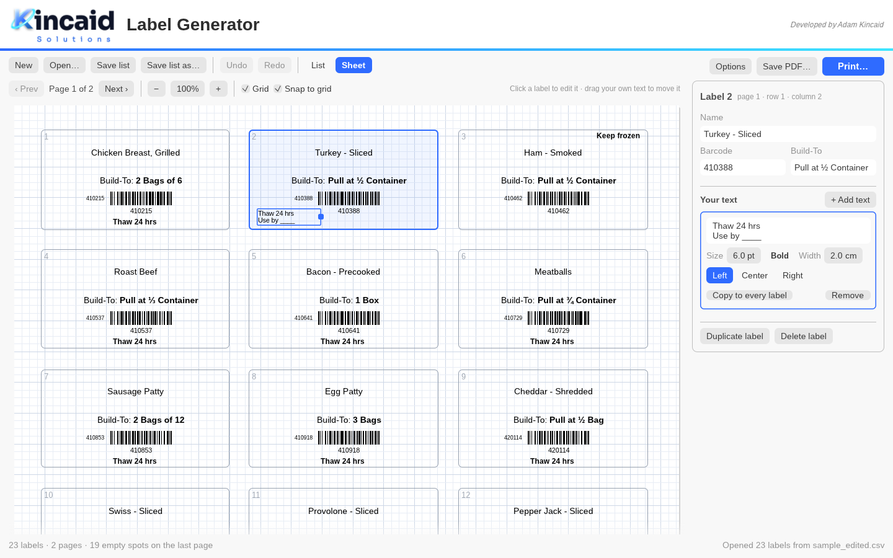
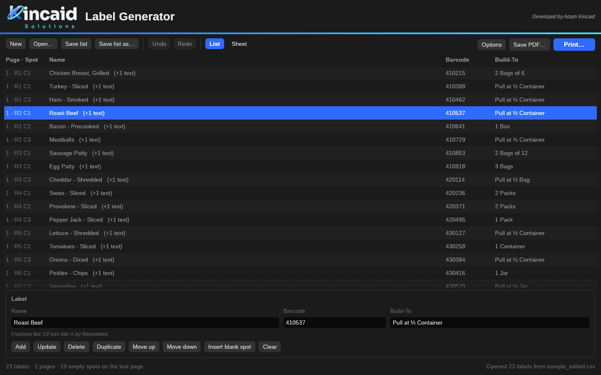
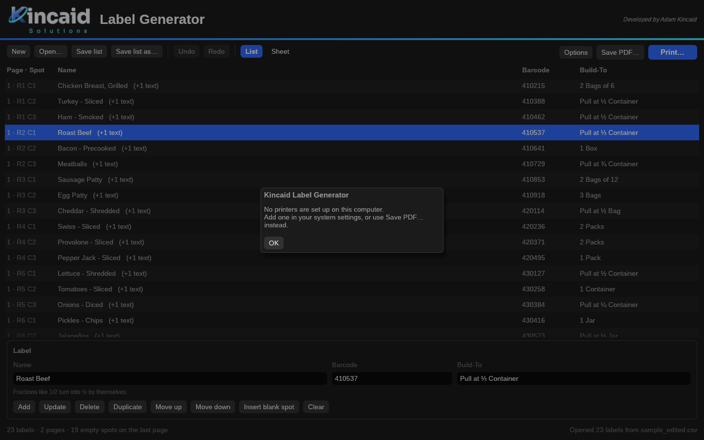

<p align="center">
  <picture>
    <source media="(prefers-color-scheme: dark)" srcset="assets/kincaid-logo-dark.svg">
    
  </picture>
</p>

<h1 align="center">Kincaid Label Generator</h1>

<p align="center">
  <b>Type a list. Get a sheet of Build-To labels, printed exactly where they belong.</b><br>
  A desktop program for Windows, Mac and Linux. Developed by Adam Kincaid.
</p>

<p align="center">
  <a href="https://github.com/Kintagious/Kincaid-Label-Generator/releases/latest"></a>
  <a href="https://github.com/Kintagious/Kincaid-Label-Generator/actions/workflows/build.yml"></a>
  
  
</p>

<p align="center">
  
</p>

Kincaid Label Generator turns a list of items (name, barcode and build-to) into a US Letter sheet of
**21 labels** (3 across, 7 down) with **Code 128 barcodes**. It prints straight to your printer at actual
size, or saves a PDF. It's a single program file with its fonts, logo and icon built in, so there's nothing
else to install.

## Download

| System | Download | Notes |
|--------|----------|-------|
| **Windows** 10 and 11 | [Kincaid-Label-Generator-Windows.exe](https://github.com/Kintagious/Kincaid-Label-Generator/releases/latest/download/Kincaid-Label-Generator-Windows.exe) | Runs on its own; copy it anywhere. |
| **Mac** (Apple Silicon and Intel) | [Kincaid-Label-Generator-Mac.zip](https://github.com/Kintagious/Kincaid-Label-Generator/releases/latest/download/Kincaid-Label-Generator-Mac.zip) | Unzip and drag the app to Applications. |
| **Linux** (regular PCs) | [kincaid-label-generator-linux-x86_64.tar.gz](https://github.com/Kintagious/Kincaid-Label-Generator/releases/latest/download/kincaid-label-generator-linux-x86_64.tar.gz) | Extract and run `./kincaid-label-generator`. |
| **Linux** (64-bit ARM, e.g. Raspberry Pi) | [kincaid-label-generator-linux-arm64.tar.gz](https://github.com/Kintagious/Kincaid-Label-Generator/releases/latest/download/kincaid-label-generator-linux-arm64.tar.gz) | Needs a 64-bit OS. |

Older versions are on the [Releases](https://github.com/Kintagious/Kincaid-Label-Generator/releases) page.

### Opening it the first time

The downloads aren't code-signed, so your computer may warn you once:

- **Windows:** if it says *Windows protected your PC*, click **More info**, then **Run anyway**.
- **Mac:** right-click the app and choose **Open**, then **Open** again.
- **Linux:** if double-clicking does nothing, run `chmod +x kincaid-label-generator` once.

## Features

- **Fast list entry.** Type the name, barcode and build-to, then press Enter. Fractions fix themselves:
  `1/2` becomes ½, and `2 1/2` becomes 2 ½.
- **See exactly where each label lands.** Every row shows its page and spot, like `1 · R2 C1`.
- **A built-in sheet editor.** See the real page on a grid, click any label to edit it, and add your own
  notes like "Use by ____" anywhere on a label.
- **Prints at true size.** Sends the sheet straight to the printer at 100%, so labels line up with the
  label stock. Or save a small PDF (about 30 KB) instead.
- **Works with your existing files.** Lists are plain `.csv` files you can also edit in Excel. It also
  opens older `.odg` label sheets so you can carry them over.
- **Light and dark mode**, following your computer's setting.

<p align="center">
  
  
</p>

## Using it

There are two views, switched with **List** and **Sheet** in the toolbar.

### List

- **Add a label:** type the Name, Barcode and Build-To, then press **Enter**. Fractions fix themselves:
  `1/2` becomes ½ (also ⅓ ⅔ ¼ ¾ ⅛ ⅜ ⅝ ⅞), and `2 1/2` or `2-1/2` becomes `2 ½`.
- **Edit a label:** click a row, change the fields, then press **Enter** (or **Update**).
- **Select several rows:** Ctrl-click (Cmd-click on a Mac) picks individual rows. Shift-click picks a range.
  **Delete**, **Duplicate** and **Move up/down** work on everything selected. The Delete key removes rows too.
- **Insert blank spot:** leaves an empty label, for skipping labels already used on a sheet.
- **Page · Spot:** shows where each label will print (R = row, C = column).
- **Open… / Save list:** lists are saved as `.csv` files. Open… also reads older `.odg` label sheets.
  You can also drag a file onto the window.
- **Options:**
  - **Print label outlines:** draws the label edges, for a test print on plain paper held up to a label sheet.
  - **Open PDF after saving:** opens each saved PDF automatically.

### Sheet: the built-in editor

The Sheet view shows the actual page: every label box outlined and numbered, a ¼ cm grid behind it
(turn it off with **Grid**), and each label drawn exactly as it will print.

- **Edit a label:** click it. Its Name, Barcode and Build-To appear on the right, and changes show up
  on the page as you type.
- **Start a new label in a particular spot:** click an empty box.
- **Add your own text:** with a label selected, click **+ Add text** and type. Use Enter for a second line.
  - **Style:** set the size, Bold, alignment (Left / Center / Right) and width.
  - **Move it:** drag it on the page. With **Snap to grid** on, it lines up on the grid. Drag the blue
    handle on its right edge to change the width.
  - **Keyboard:** arrow keys nudge the selected text, and Delete removes it.
  - **Copy to every label:** puts the same text in the same place on all your labels.
- **Pages:** **‹ Prev / Next ›** move between pages. **− / + / %** zoom (click the % to fit the width).
- **Saving:** your own text is saved with the list in an extra CSV column, and the List view marks
  those labels with "(+1 text)".

### Printing

**Print…** sends the labels straight to the printer at actual size. Pick the printer, number of copies and
which pages.

- **Windows:** the program draws each label directly on the printer page using Windows' own printing,
  placing every letter and bar exactly where the PDF puts it.
- **Mac and Linux:** it uses the computer's print system (CUPS) with scaling turned off.

If you print a saved PDF yourself, choose **Actual size / 100%**, not "Fit to page", or the labels won't
line up.

### Keyboard shortcuts

Ctrl (Cmd on a Mac) plus:

| Key | Action | Key | Action |
|-----|--------|-----|--------|
| **N** | New list | **P** | Print |
| **O** | Open | **E** | Save PDF |
| **S** | Save list | **Z** | Undo |
| | | **Y** or **Shift+Z** | Redo |

### Command line

```
kincaid-label-generator Sample_List.csv -o Sample_List.pdf      # make a PDF without opening the window
kincaid-label-generator Sample_List.csv -o test.pdf --outlines   # with label edges drawn
kincaid-label-generator Sample_List.csv                          # open the window with a list loaded
```

To force light or dark mode, set `LABEL_THEME=light` or `LABEL_THEME=dark`.

### List file format

A list is a plain CSV file with a header row. The fourth column is optional and is written by the sheet
editor. Try [`assets/Sample_List.csv`](assets/Sample_List.csv).

```csv
Name,Barcode,Build-To
"Chicken Breast, Grilled",410215,2 Bags of 6
Turkey - Sliced,410388,Pull at ½ Container
```

## How accurate is it?

The layout was measured from the original label sheet and checked against a PDF of it:

- **Barcodes:** all 576 bars on a full page land within 0.01 mm of the original. They're sharp vector
  bars (Code 128, set B), not pictures.
- **Text:** every line lands within about 0.1 mm, using the same font (Liberation Sans), kerning and
  font sizes.
- **Small files:** only the letters actually used are embedded, so a sheet is about 30 KB.

## Building from source

Install Rust from <https://rustup.rs>, then:

| System  | Steps |
|---------|-------|
| Windows | Double-click `packaging\windows\build.bat`. The Rust installer offers to install the Microsoft C++ build tools it needs. |
| Mac     | Run `xcode-select --install` once, then `bash packaging/macos/make-app.sh`. This gives you `target/Kincaid Label Generator.app`. |
| Linux   | Run `sudo apt install libgtk-3-dev` (or your distribution's equivalent), then `./packaging/linux/install.sh`. This also adds it to your app menu. |

Or run `cargo run --release` on any of them, and `cargo test` to run the tests.

### Releases

GitHub builds all four downloads automatically (`.github/workflows/build.yml`):

- **Test build:** open **Actions → Build → Run workflow**, and download the results from the run page.
- **Release:** create a release with a new tag such as `v2.3.0` (on the **Releases** page, or
  `git tag v2.3.0 && git push origin v2.3.0`). When the builds finish, they're attached to the release.
  The file names never change, so the download links above always point to the newest version.

Remember to update `version` in `Cargo.toml` first.

## Project layout

```
src/main.rs     starts the window, or the command line
src/app.rs      the window
src/pdf.rs      lays out the page (shared by the Sheet view) and writes the PDF
src/sheet.rs    the Sheet view (page preview, grid, your own text)
src/print.rs    printing (CUPS on Mac/Linux, Windows GDI)
src/labels.rs   layout measurements, barcodes, fractions, CSV and .odg reading (with tests)
assets/         logos, the app icon (icon.svg is its source), the bundled fonts, a sample list
docs/           screenshots for this page
packaging/      build scripts for Windows, Mac and Linux
```

## Credits

Developed by **Adam Kincaid**, Kincaid Solutions.

The Liberation Sans fonts are © Red Hat and others, under the SIL Open Font License 1.1
(see [`assets/fonts/LICENSE-OFL.txt`](assets/fonts/LICENSE-OFL.txt)), which allows bundling them with the program.
